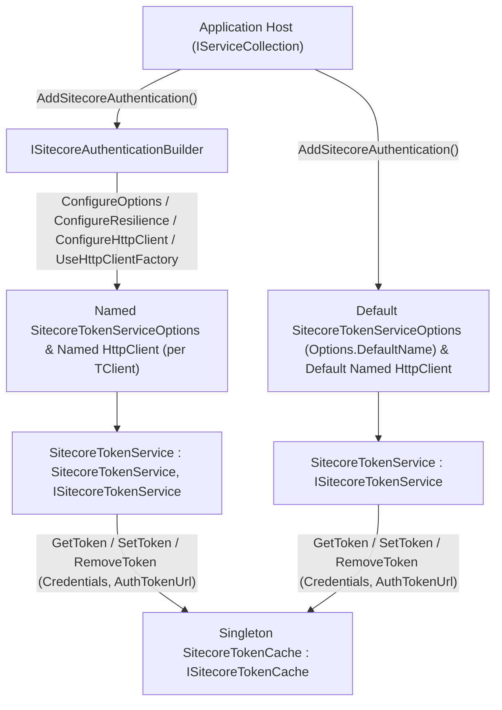

# .NET 10/11 Target Upgrade and Typed Multi-Client Authentication (`ISitecoreTokenService<TClient>`)

*   **Author:** Aaron Metz (`acmetz`)
*   **Status:** Approved / Implemented (v1.1.0)
*   **Date:** 2026-11-11

--------------------------------------------------------------------------------

## Overview

`Sitecore.API.Foundation.Authorization` provides OAuth2 client-credentials token acquisition, thread-safe in-memory caching, and HTTP resilience for .NET applications integrating with Sitecore Cloud services.

This design covers two coordinated updates for the next release:
1.  **Target Framework Modernization (`net10.0;net11.0`)**: Updating the library, unit test suite, integration test suite, `BenchmarkDotNet` benchmark suite, and GitHub Actions CI/CD pipelines (`pr-check.yml` and `nuget-release.yml`) to target `.NET 10` (LTS) and `.NET 11` (STS) while dropping `.NET 8` and `.NET 9`, which have reached end of support. Historical `.NET 8.0` and `.NET 9.0` benchmark metrics remain documented in [`README.md`](../../README.md) so consumers can compare runtime performance across generations.
2.  **Typed Multi-Client Registration (`AddSitecoreAuthentication<TClient>()`)**: Adding generic dependency injection registration methods that return a fluent `ISitecoreAuthenticationBuilder<TClient>` and register `ISitecoreTokenService<TClient> : ISitecoreTokenService`. This allows multiple consumers in the same application host to configure distinct `AuthTokenUrl` endpoints, HTTP resilience pipelines, and `HttpClient` settings per consumer type while sharing a single process-wide `ISitecoreTokenCache` singleton partitioned by `(ClientId, ClientSecret, AuthTokenUrl)`.

## The Problem

1.  **Global Single-Registration Bottleneck in Multi-Client Applications**:
    Today, [`ServiceCollectionExtensions`](../../src/Sitecore.API.Foundation.Authorization/DependencyInjection/ServiceCollectionExtensions.cs) only registers a single untyped [`ISitecoreTokenService`](../../src/Sitecore.API.Foundation.Authorization/Abstractions/ISitecoreTokenService.cs) bound to the default unnamed `IOptions<SitecoreTokenServiceOptions>` and a single named `HttpClient` (`"SitecoreAuthClient"`). When an application integrates with multiple Sitecore environments or APIs simultaneously (for example, XM Cloud Authoring, XM Cloud Delivery, Content Hub, or separate Staging and Production tenants), all consumers are forced to share the same `AuthTokenUrl`, `HttpClient` configuration, and retry/circuit-breaker pipeline.
2.  **Collision Risk with `AddHttpClient<TClient>()`**:
    Consumers of this library are typically typed HTTP client classes registered with `services.AddHttpClient<TClient>()`. If typed authentication registration attempted to register `TClient` directly in the dependency injection container or reused `typeof(TClient).Name` as the `HttpClient` name, it would overwrite the consumer's `TClient` registration or pollute the consumer's API `HttpClient` settings (`BaseAddress`, default headers, and handlers).
3.  **Cross-Endpoint Cache Collision in a Shared Token Cache**:
    [`SitecoreTokenCache`](../../src/Sitecore.API.Foundation.Authorization/Services/SitecoreTokenCache.cs) currently indexes cached tokens exclusively by `SitecoreAuthClientCredentials(ClientId, ClientSecret)`. When a single shared `ISitecoreTokenCache` singleton serves multiple typed services configured with different `AuthTokenUrl` endpoints, identical client credentials across two endpoints collide in the cache and return tokens issued by the wrong authentication server.
4.  **Out-of-Support Target Frameworks (`.NET 8` and `.NET 9`)**:
    With the release of `.NET 11` in November 2026, both `.NET 8` (LTS) and `.NET 9` (STS) have reached end of support. Retaining `net8.0` and `net9.0` alongside `net10.0` and `net11.0` increases CI matrix build, test, and packaging overhead for runtimes that no longer receive security servicing.

## Goals

*   Update `<TargetFrameworks>` across all four `.csproj` files (`Sitecore.API.Foundation.Authorization`, `Sitecore.API.Foundation.Tests`, `Sitecore.API.Foundation.Authorization.IntegrationTests`, and `Sitecore.API.Foundation.Authorization.Benchmarks`) to `net10.0;net11.0`.
*   Update [`global.json`](../../global.json) (`11.0.100`), [`Directory.Packages.props`](../../Directory.Packages.props) (`Microsoft.Extensions.*` `11.0.0` and `BenchmarkDotNet` `0.16.0-preview.2`), [`.github/workflows/pr-check.yml`](../../.github/workflows/pr-check.yml), [`.github/workflows/nuget-release.yml`](../../.github/workflows/nuget-release.yml), and [`TokenCacheBenchmarks.cs`](../../tests/Sitecore.API.Foundation.Authorization.Benchmarks/TokenCacheBenchmarks.cs) (`RuntimeMoniker.Net10_0` and `RuntimeMoniker.Net11_0`).
*   Preserve historical `.NET 8.0` and `.NET 9.0` benchmark tables in [`README.md`](../../README.md) alongside the updated `.NET 10.0` and `.NET 11.0` benchmark results.
*   Introduce `ISitecoreTokenService<TClient> : ISitecoreTokenService` (in `Abstractions`) and `SitecoreTokenService<TClient>` (in `Services`) so typed consumers can inject `ISitecoreTokenService<TClient>` alongside `HttpClient` from `AddHttpClient<TClient>()` without DI collisions.
*   Introduce `AddSitecoreAuthentication<TClient>(...)` (scoped) and `AddSitecoreAuthenticationSingleton<TClient>(...)` (singleton) returning a fluent `ISitecoreAuthenticationBuilder<TClient>` (in `DependencyInjection`) supporting per-type options, `IConfiguration` binding, HTTP standard resilience, `IHttpClientBuilder` customization, and custom `HttpClient` factory delegates.
*   Maintain 100% source and binary backward compatibility for all existing non-generic `AddSitecoreAuthentication(...)` and `AddSitecoreAuthenticationSingleton(...)` overloads returning `IServiceCollection`.
*   Maintain a single shared `ISitecoreTokenCache` singleton across all untyped and typed token services, configured globally for cache capacity and cleanup settings (`MaxCacheSize`, `CleanupThreshold`, `CleanupInterval`), while partitioning cached tokens by `(ClientId, ClientSecret, AuthTokenUrl)` and providing default interface method forwarding on `ISitecoreTokenCache`.

## Non-Goals

*   Creating separate `ISitecoreTokenCache` instances or separate cleanup state and locks per typed client.
*   Registering the consumer class `TClient` itself in `IServiceCollection` or altering the `HttpClient` registered by the consumer's own `services.AddHttpClient<TClient>()` call.
*   Retaining `net8.0` or `net9.0` compilation targets in the NuGet package or test projects.
*   Changing the return type of existing non-generic `AddSitecoreAuthentication` or `AddSitecoreAuthenticationSingleton` methods from `IServiceCollection`.

## Open Questions

*   None — all architectural and lifecycle questions were resolved during the brainstorm phase.

## Critical User Journeys (CUJs)

### CUJ 1: Consumer Registers Typed Authentication Alongside `AddHttpClient<TClient>()`

*   **Given**: An application has two Sitecore API client classes, `XmCloudStagingClient` and `XmCloudProductionClient`, each registered via `services.AddHttpClient<TClient>()` and injecting `(HttpClient httpClient, ISitecoreTokenService<TClient> tokenService)`.
*   **When**: The application registers `services.AddSitecoreAuthentication<XmCloudStagingClient>().ConfigureOptions(o => o.AuthTokenUrl = "https://staging-auth.sitecorecloud.io/oauth/token").ConfigureResilience(...)` and `services.AddSitecoreAuthentication<XmCloudProductionClient>().ConfigureOptions(o => o.AuthTokenUrl = "https://auth.sitecorecloud.io/oauth/token")`.
*   **Then**: Both clients resolve their own `HttpClient` and their respective `ISitecoreTokenService<TClient>` without DI descriptor or named `HttpClient` collisions; token requests use each client's configured `AuthTokenUrl` and resilience pipeline; and tokens cached in the shared `ISitecoreTokenCache` singleton are isolated by `(ClientId, ClientSecret, AuthTokenUrl)`.

### CUJ 2: Existing Untyped Consumer Upgrades Without Code Changes

*   **Given**: An existing application on `.NET 10` or `.NET 11` registers `services.AddSitecoreAuthentication(configuration)` and injects `ISitecoreTokenService`, or registers a custom `ISitecoreTokenCache` implementation that only implements the 1-argument `GetToken(credentials)` and 2-argument `SetToken(credentials, token)` methods.
*   **When**: The application upgrades to the new package version.
*   **Then**: All existing registration calls, `IServiceCollection` method chains, `ISitecoreTokenService` resolutions, and custom `ISitecoreTokenCache` implementations compile and behave identically without modification.

### CUJ 3: Developer Builds, Tests, and Benchmarks on `.NET 10` and `.NET 11`

*   **Given**: A developer or CI runner with `.NET 10` and `.NET 11` SDKs installed.
*   **When**: Running `dotnet build --configuration Release`, `dotnet test --configuration Release`, or running the `BenchmarkDotNet` suite, and reviewing [`README.md`](../../README.md).
*   **Then**: All four projects build and pass tests across `net10.0` and `net11.0` with zero warnings, `GitHubWorkflowTests` verifies workflow alignment for `10.0.x` and `11.0.x`, and [`README.md`](../../README.md) displays both the `.NET 10.0`/`.NET 11.0` benchmarks and the preserved historical `.NET 8.0`/`.NET 9.0` benchmarks.

## Technical Plan (Architecture)

### 1. Component Architecture & Data Flow

The architecture extends the existing four-module acyclic dependency structure (`Models` <- `Abstractions`, `Configuration`, `Exceptions` <- `Services` <- `DependencyInjection`) without introducing circular or upward dependencies.



```text
+-----------------------------------------------------------------------------------+
| Application Consumer: MyXmCloudClient(HttpClient, ISitecoreTokenService<MyClient>)|
+--------------------+---------------------------------------------+----------------+
                     |                                             |
       Injected via  |                               Injected via  |
  AddHttpClient<T>() |                 AddSitecoreAuthentication<T>()
                     v                                             v
+--------------------+--------------------+   +--------------------+----------------+
| Consumer's Own API HttpClient           |   | SitecoreTokenService<MyClient>      |
| (Named: "MyXmCloudClient")              |   | - Named Options: "...Options.T"     |
+-----------------------------------------+   | - Named HttpClient: "...HttpClient.T"|
                                              +--------------------+----------------+
                                                                   |
                                           Look up / Store / Evict |
                                       Key: (Credentials, AuthUrl) |
                                                                   v
                                              +--------------------+----------------+
                                              | Singleton SitecoreTokenCache        |
                                              | - Global Options (Options.Default)  |
                                              | - MaxCacheSize / CleanupInterval    |
                                              +-------------------------------------+
```

### 2. Typed Token Service Contract (`Abstractions` & `Services`)

1.  **`ISitecoreTokenService<TClient>` ([`ISitecoreTokenService.cs`](../../src/Sitecore.API.Foundation.Authorization/Abstractions/ISitecoreTokenService.cs))**:
    *   Declared as `public interface ISitecoreTokenService<TClient> : ISitecoreTokenService where TClient : class`.
    *   Because `ISitecoreTokenService<TClient>` inherits all four methods (`GetSitecoreAuthToken` and `TryRefreshSitecoreAuthToken` with and without `CancellationToken`) from `ISitecoreTokenService` and resides in `Sitecore.API.Foundation.Authorization.Abstractions`, `Abstractions` continues to depend only on `Models`.
2.  **`SitecoreTokenService<TClient>` ([`SitecoreTokenService.cs`](../../src/Sitecore.API.Foundation.Authorization/Services/SitecoreTokenService.cs))**:
    *   Declared as `public class SitecoreTokenService<TClient> : SitecoreTokenService, ISitecoreTokenService<TClient> where TClient : class`.
    *   In `SitecoreTokenService`, the internal logger field type is widened from `ILogger<SitecoreTokenService>?` to `ILogger?`. The existing public constructor `public SitecoreTokenService(HttpClient httpClient, ISitecoreTokenCache tokenCache, IOptions<SitecoreTokenServiceOptions> options, ILogger<SitecoreTokenService>? logger = null)` is preserved unchanged for binary and source compatibility, while a `protected SitecoreTokenService(HttpClient httpClient, ISitecoreTokenCache tokenCache, IOptions<SitecoreTokenServiceOptions> options, ILogger? logger)` constructor overload allows `SitecoreTokenService<TClient>` to pass `ILogger<SitecoreTokenService<TClient>>?`.

### 3. Fluent Builder & Dependency Injection (`DependencyInjection`)

1.  **`ISitecoreAuthenticationBuilder<TClient>` (`DependencyInjection/ISitecoreAuthenticationBuilder.cs`)**:
    *   Placed in `Sitecore.API.Foundation.Authorization.DependencyInjection` alongside [`ServiceCollectionExtensions`](../../src/Sitecore.API.Foundation.Authorization/DependencyInjection/ServiceCollectionExtensions.cs) so callers already importing that namespace have immediate access without polluting `Abstractions` with `Microsoft.Extensions.*` dependencies.
    *   Exposes:
        *   `IServiceCollection Services { get; }`
        *   `ISitecoreAuthenticationBuilder<TClient> ConfigureOptions(Action<SitecoreTokenServiceOptions> configureOptions)`
        *   `ISitecoreAuthenticationBuilder<TClient> ConfigureOptions(IConfiguration configuration, string sectionName = "SitecoreAuthentication")`
        *   `ISitecoreAuthenticationBuilder<TClient> ConfigureResilience(Action<HttpStandardResilienceOptions>? configureResilience = null)`
        *   `ISitecoreAuthenticationBuilder<TClient> ConfigureHttpClient(Action<IHttpClientBuilder> configureClient)`
        *   `ISitecoreAuthenticationBuilder<TClient> UseHttpClientFactory(Func<IServiceProvider, HttpClient> httpClientFactory)`
2.  **Naming Isolation & Registration Mechanics ([`ServiceCollectionExtensions.cs`](../../src/Sitecore.API.Foundation.Authorization/DependencyInjection/ServiceCollectionExtensions.cs) & `ISitecoreAuthenticationBuilder.cs`)**:
    *   Each `TClient` uses deterministic internal names derived from `typeof(TClient).AssemblyQualifiedName ?? typeof(TClient).FullName ?? typeof(TClient).Name`:
        *   Named `HttpClient`: `$"{Constants.SitecoreHttpClientName}.{typeName}"`
        *   Named `SitecoreTokenServiceOptions`: `$"{Constants.SitecoreOptionsNamePrefix}.{typeName}"`
    *   `AddSitecoreAuthentication<TClient>(...)` (scoped) and `AddSitecoreAuthenticationSingleton<TClient>(...)` (singleton) provide entry-point overloads accepting optional `Action<SitecoreTokenServiceOptions>?` or `(IConfiguration, string sectionName = Constants.DefaultConfigurationSectionName)`.
    *   Inside `AddTypedCoreServices<TClient>`:
        *   Calls `services.AddOptions<SitecoreTokenServiceOptions>()` so `IOptions<SitecoreTokenServiceOptions>` (`Options.DefaultName`) always resolves for the singleton `SitecoreTokenCache` even when only typed registrations are called.
        *   Calls `services.AddHttpClient(clientName)` to obtain the per-type `IHttpClientBuilder`.
        *   Registers `services.TryAddSingleton<ISitecoreTokenCache, SitecoreTokenCache>()`.
        *   Uses `GetOrAddTypedBuilder<TClient>(services, httpClientBuilder, optionsName)` backed by a `ConditionalWeakTable<IServiceCollection, ConcurrentDictionary<Type, object>>` (`TypedBuilders`) to reuse the active `SitecoreAuthenticationBuilder<TClient>` and its `TypedHttpClientFactoryHolder` across repeated calls for the same `(services, TClient)` without registering the builder in `IServiceCollection` or retaining `IServiceCollection` globally. On first registration, Singleton registrations configure `SocketsHttpHandler.PooledConnectionLifetime` (2 minutes) via `ConfigureSingletonConnectionLifetime`.
        *   Registers `ISitecoreTokenService<TClient>` via `services.TryAdd(new ServiceDescriptor(typeof(ISitecoreTokenService<TClient>), sp => ..., lifetime))`. When resolved, the factory reads the per-type `SitecoreTokenServiceOptions` from `sp.GetRequiredService<IOptionsMonitor<SitecoreTokenServiceOptions>>().Get(optionsName)` wrapped in `Options.Create(...)`, resolves the `HttpClient` from `clientFactoryHolder.Factory(sp)` (if configured via `.UseHttpClientFactory(...)`) or `IHttpClientFactory.CreateClient(clientName)`, and injects the singleton `ISitecoreTokenCache` and `ILogger<SitecoreTokenService<TClient>>`.

### 4. Endpoint-Partitioned Shared Cache ([`ISitecoreTokenCache.cs`](../../src/Sitecore.API.Foundation.Authorization/Abstractions/ISitecoreTokenCache.cs) & [`SitecoreTokenCache.cs`](../../src/Sitecore.API.Foundation.Authorization/Services/SitecoreTokenCache.cs))

1.  **Interface Evolution with Default Interface Forwarding (`ISitecoreTokenCache`)**:
    *   Retains existing methods:
        *   `SitecoreAuthToken? GetToken(SitecoreAuthClientCredentials credentials);`
        *   `void SetToken(SitecoreAuthClientCredentials credentials, SitecoreAuthToken token);`
        *   `SitecoreAuthClientCredentials? RemoveToken(SitecoreAuthToken token);`
    *   Adds `AuthTokenUrl`-aware overloads with default interface forwarding for backward compatibility with custom `ISitecoreTokenCache` implementations:
        *   `SitecoreAuthToken? GetToken(SitecoreAuthClientCredentials credentials, string authTokenUrl) => GetToken(credentials);`
        *   `void SetToken(SitecoreAuthClientCredentials credentials, SitecoreAuthToken token, string authTokenUrl) => SetToken(credentials, token);`
        *   `SitecoreAuthClientCredentials? RemoveToken(SitecoreAuthToken token, string authTokenUrl) => RemoveToken(token);`
2.  **Composite Key Storage (`SitecoreTokenCache`) & Deterministic Service Dispatch (`SitecoreTokenService`)**:
    *   Replaces `ConcurrentDictionary<SitecoreAuthClientCredentials, SitecoreAuthToken>` with `ConcurrentDictionary<SitecoreTokenCacheKey, SitecoreAuthToken>`, where `private readonly record struct SitecoreTokenCacheKey(SitecoreAuthClientCredentials Credentials, string AuthTokenUrl)` stores the credentials and normalized `AuthTokenUrl` computed via `string.IsNullOrWhiteSpace(authTokenUrl) ? (_options.AuthTokenUrl?.Trim() ?? string.Empty) : authTokenUrl.Trim()`.
    *   In `SitecoreTokenCache`:
        *   The 1-argument `GetToken(credentials)` and 2-argument `SetToken(credentials, token)` methods delegate to `GetToken(credentials, _options.AuthTokenUrl)` and `SetToken(credentials, token, _options.AuthTokenUrl)`.
        *   Both `RemoveToken(SitecoreAuthToken token)` and `RemoveToken(SitecoreAuthToken token, string authTokenUrl)` delegate to `RemoveTokenCore(SitecoreAuthToken token, string? normalizedAuthTokenUrl)`. The 1-argument overload passes `normalizedAuthTokenUrl: null` to match the first entry where `kvp.Value.Equals(token)` and remove it via `_tokens.TryRemove(kvp)`, while the 2-argument overload passes `NormalizeAuthTokenUrl(authTokenUrl)` to require both `kvp.Value.Equals(token)` and `string.Equals(kvp.Key.AuthTokenUrl, normalizedAuthTokenUrl, StringComparison.Ordinal)`, preventing a typed service bound to Endpoint B from evicting and refreshing a token issued by Endpoint A.
    *   In `SitecoreTokenService`:
        *   The constructor precomputes `private readonly bool _useLegacyCacheFallback = IsDynamicProxyCache(_tokenCache);` (detecting runtime dynamic proxy mocks such as `Castle.Proxies`, `DynamicProxyGenAssembly2`, or `DispatchProxy` that intercept C# default interface methods without executing their default forwarding body).
        *   When `!_useLegacyCacheFallback` (including `SitecoreTokenCache` and all concrete custom `ISitecoreTokenCache` implementations), `SitecoreTokenService` calls only `_tokenCache.GetToken(credentials, _options.AuthTokenUrl)`, `_tokenCache.SetToken(credentials, sitecoreToken, _options.AuthTokenUrl)`, and `_tokenCache.RemoveToken(token, _options.AuthTokenUrl)` via private helpers (`GetCachedToken`, `CacheToken`, `RemoveCachedToken`), preventing duplicate invocations on legacy custom caches and preventing cross-endpoint fallback leakage on endpoint-aware custom caches.
        *   When `_useLegacyCacheFallback` is `true` (dynamic proxy mocks in unit tests), `GetCachedToken` and `RemoveCachedToken` try the `authTokenUrl` overload first and coalesce (`??`) to the 1-arg overload, while `CacheToken` writes both 3-arg and 2-arg `SetToken`.

### 5. `.NET 10` and `.NET 11` Target Framework & CI/CD Upgrade

1.  **Project & Package Configuration**:
    *   [`Directory.Build.props`](../../Directory.Build.props) sets `<LangVersion>15.0</LangVersion>`.
    *   All four `.csproj` files set `<TargetFrameworks>net10.0;net11.0</TargetFrameworks>`.
    *   [`global.json`](../../global.json) sets `"version": "11.0.100"` with `"rollForward": "latestFeature"` and `"allowPrerelease": false`.
    *   [`Directory.Packages.props`](../../Directory.Packages.props) upgrades `Microsoft.Extensions.*` packages (including direct `Microsoft.Extensions.Options.ConfigurationExtensions` `11.0.0` in [`Sitecore.API.Foundation.Authorization.csproj`](../../src/Sitecore.API.Foundation.Authorization/Sitecore.API.Foundation.Authorization.csproj)) from `10.0.0` to `11.0.0` and `BenchmarkDotNet` from `0.15.8` to `0.16.0-preview.2`.
2.  **Benchmarks & Historical Documentation**:
    *   [`TokenCacheBenchmarks.cs`](../../tests/Sitecore.API.Foundation.Authorization.Benchmarks/TokenCacheBenchmarks.cs) and [`Program.cs`](../../tests/Sitecore.API.Foundation.Authorization.Benchmarks/Program.cs) configure `RuntimeMoniker.Net10_0` and `RuntimeMoniker.Net11_0` as default jobs when run without arguments while allowing `--runtimes` CLI selection.
    *   [`README.md`](../../README.md) updates the active benchmark section with `.NET 10.0` and `.NET 11.0` results while preserving the existing `.NET 8.0` and `.NET 9.0` table in a dedicated historical benchmarks subsection.
3.  **GitHub Actions Workflows**:
    *   [`.github/workflows/pr-check.yml`](../../.github/workflows/pr-check.yml) and [`.github/workflows/nuget-release.yml`](../../.github/workflows/nuget-release.yml) replace `8.0.x` and `9.0.x` with `10.0.x` and `11.0.x`, build `-p:TargetFramework=net10.0` and `-p:TargetFramework=net11.0`, and set the `release` job SDK in `nuget-release.yml` to `11.0.x` so all contract checks in [`GitHubWorkflowTests.cs`](../../tests/Sitecore.API.Foundation.Tests/GitHubWorkflowTests.cs) pass.

## Alternatives Considered

### Alternative A: Direct `TClient` DI Registration (Copying `AddHttpClient<TClient>`'s Transient Registration)

*   **Pros**: Allows consumer classes to inject the untyped `ISitecoreTokenService` interface directly in their constructors while still receiving a per-type `SitecoreTokenService` instance constructed via `ActivatorUtilities.CreateInstance<TClient>`.
*   **Cons**: Registers `TClient` itself in `IServiceCollection` via a factory delegate. When a consumer class also uses `services.AddHttpClient<TClient>()` for its own HTTP API calls, the second registration overwrites the first `ServiceDescriptor` for `TClient` in the DI container.
*   **Reason for Rejection**: Rejected by author: Registering `TClient` directly in DI collides with `services.AddHttpClient<TClient>()` when a consumer uses both a typed `HttpClient` for Sitecore API calls and typed authentication.

### Alternative B: Isolated Per-Type `ISitecoreTokenCache` Instances

*   **Pros**: Gives each typed registration its own `MaxCacheSize`, `CleanupThreshold`, and `CleanupInterval` settings without modifying cache keys.
*   **Cons**: Multiplies in-memory cache instances and cleanup locks across every registered `TClient` type, prevents token sharing when two typed clients authenticate against the same endpoint with the same credentials, and duplicates OAuth token requests.
*   **Reason for Rejection**: Rejected by author: A single shared `ISitecoreTokenCache` singleton across the application avoids duplicate token requests and redundant cleanup overhead while composite keys `(ClientId, ClientSecret, AuthTokenUrl)` isolate endpoints.

### Alternative C: Changing Existing Non-Generic `AddSitecoreAuthentication` Overloads to Return `ISitecoreAuthenticationBuilder`

*   **Pros**: Unified builder return type across both generic and non-generic registration methods.
*   **Cons**: Breaks binary compatibility and breaks source compatibility for existing callers that chain other `IServiceCollection` extension methods directly after `services.AddSitecoreAuthentication(...)`.
*   **Reason for Rejection**: Rejected by author: Keeping existing non-generic `AddSitecoreAuthentication` and `AddSitecoreAuthenticationSingleton` overloads returning `IServiceCollection` preserves source and binary backward compatibility, while returning `ISitecoreAuthenticationBuilder<TClient>` on the new generic `<TClient>` methods provides fluent configuration.

### Alternative D: Retaining `net8.0` and `net9.0` Alongside `net10.0` and `net11.0`

*   **Pros**: Allows consumers still running on `.NET 8` or `.NET 9` runtimes to upgrade to the new package version without upgrading their target framework.
*   **Cons**: Both `.NET 8` (LTS) and `.NET 9` (STS) reach end of support by November 2026; keeping four target frameworks increases CI matrix build, test, and benchmark execution time for unsupported runtimes.
*   **Reason for Rejection**: Rejected by author: Target frameworks that are out of support or within six months of end-of-support are dropped, while historical `.NET 8.0` and `.NET 9.0` benchmark tables are retained in [`README.md`](../../README.md) for reference.

### Alternative E: Placing `ISitecoreAuthenticationBuilder<TClient>` in `Abstractions`

*   **Pros**: Groups all public interfaces in the `Sitecore.API.Foundation.Authorization.Abstractions` namespace.
*   **Cons**: Forces `Abstractions` to depend on `Configuration` (`SitecoreTokenServiceOptions`), `Microsoft.Extensions.Configuration.Abstractions`, `Microsoft.Extensions.DependencyInjection.Abstractions`, and `Microsoft.Extensions.Http.Resilience`, violating the architecture invariant that `Abstractions` depends only on `Models`.
*   **Reason for Rejection**: Rejected by author: Placing `ISitecoreAuthenticationBuilder<TClient>` in `Sitecore.API.Foundation.Authorization.DependencyInjection` preserves the acyclic module boundary where `Abstractions` depends only on `Models`.

--------------------------------------------------------------------------------

## Non-Functional Requirements

*   **Security & Privacy**:
    *   Each per-type `SitecoreTokenService<TClient>` enforces the same HTTPS (or loopback HTTP) and no-userinfo URI validation on its configured `AuthTokenUrl` as the untyped service.
    *   Composite cache keys `SitecoreTokenCacheKey(SitecoreAuthClientCredentials Credentials, string AuthTokenUrl)` never log `ClientSecret` or raw bearer tokens, preserving existing credential masking guarantees.
*   **Performance & Latency**:
    *   `SitecoreTokenCacheKey` is a `readonly record struct` wrapping `SitecoreAuthClientCredentials` (already a `readonly record struct`) and `string AuthTokenUrl`, avoiding heap allocations on cache lookups (`GetToken` remains zero-allocation on cache hits).
    *   Sharing a single `SitecoreTokenCache` singleton avoids spinning up additional `System.Threading.Lock` instances per typed client.
*   **Rollout & Backward Compatibility**:
    *   All existing public methods, constructors, and extension method signatures remain intact.
    *   `ISitecoreTokenCache` uses C# default interface methods on the new `authTokenUrl`-aware overloads so external custom `ISitecoreTokenCache` implementations continue to compile and execute without changes.

### Risks, Limits & Mitigations

*   **Ignored Per-Client Cache Capacity Properties on Named Options**:
    *   *Risk / Constraint*: `SitecoreTokenServiceOptions` contains both endpoint settings (`AuthTokenUrl`) and cache policy settings (`MaxCacheSize`, `CleanupThreshold`, `CleanupInterval`). Because the shared `SitecoreTokenCache` singleton resolves the unnamed default `IOptions<SitecoreTokenServiceOptions>` (`Options.DefaultName`), mutating `MaxCacheSize`, `CleanupThreshold`, or `CleanupInterval` inside `AddSitecoreAuthentication<TClient>(o => ...)` or `ISitecoreAuthenticationBuilder<TClient>.ConfigureOptions(o => ...)` affects only the named options for `TClient` and is not read by `SitecoreTokenCache`.
    *   *Mitigation*: Global cache capacity and cleanup settings must be configured via `services.Configure<SitecoreTokenServiceOptions>(...)` or the non-generic `AddSitecoreAuthentication(...)` registration; this constraint is documented in XML comments on `ISitecoreAuthenticationBuilder<TClient>.ConfigureOptions` and in [`docs/README.md`](../README.md).
*   **Shared Cache Capacity Contention Across Many Typed Clients**:
    *   *Risk / Limit*: All untyped and typed token services share `MaxCacheSize` (default `10`) in the singleton `SitecoreTokenCache`. Applications registering more than 10 concurrent `(ClientId, ClientSecret, AuthTokenUrl)` entries will trigger `EvictOldestTokensUnsafe()` priority-queue eviction on `SetToken`.
    *   *Mitigation*: Applications with high client/endpoint cardinality should increase global `MaxCacheSize` and `CleanupThreshold` on the default `SitecoreTokenServiceOptions`.
*   **Preview Benchmark Package Dependency (`BenchmarkDotNet 0.16.0-preview.2`)**:
    *   *Risk / Constraint*: `BenchmarkDotNet` `0.15.8` does not define `RuntimeMoniker.Net11_0`; `0.16.0-preview.2` is a preview release.
    *   *Mitigation*: `BenchmarkDotNet` is referenced exclusively by [`Sitecore.API.Foundation.Authorization.Benchmarks.csproj`](../../tests/Sitecore.API.Foundation.Authorization.Benchmarks/Sitecore.API.Foundation.Authorization.Benchmarks.csproj) (`<IsPackable>false</IsPackable>`) and never ships as a dependency of the published `SitecoreAPIAuthorization` NuGet package.

--------------------------------------------------------------------------------

## Detailed Implementation Plan

### Phase 1: `.NET 10` & `.NET 11` SDK, Package Dependencies, Project TFMs, Benchmarks & CI/CD Workflows

#### 1. [`global.json`](../../global.json) (Modify)

*   **Type / Scope**: SDK Build Configuration
*   **Proposed Changes**: Update `sdk.version` from `"10.0.100"` to `"11.0.100"`, retaining `"rollForward": "latestFeature"` and setting `"allowPrerelease": false`.
*   **Rationale**: Aligns the repository SDK constraint with `.NET 11` and satisfies the contract test in [`GitHubWorkflowTests.cs`](../../tests/Sitecore.API.Foundation.Tests/GitHubWorkflowTests.cs).

#### 2. [`Directory.Packages.props`](../../Directory.Packages.props) & [`Directory.Build.props`](../../Directory.Build.props) (Modify)

*   **Type / Scope**: Central Package Management & Shared Build Configuration
*   **Proposed Changes**:
    *   Update `Directory.Build.props` `<LangVersion>` to `15.0`.
    *   Update the inline comment in `Directory.Packages.props` line 7 from `<!-- Core dependencies - using .NET 10 compatible versions -->` to `<!-- Core dependencies - using .NET 10 and .NET 11 compatible versions -->`.
    *   Update `Microsoft.Extensions.Configuration.Abstractions`, `Microsoft.Extensions.DependencyInjection.Abstractions`, `Microsoft.Extensions.Http`, `Microsoft.Extensions.Http.Resilience`, `Microsoft.Extensions.Options`, `Microsoft.Extensions.Options.ConfigurationExtensions` (referenced directly by the main library), `Microsoft.Extensions.Logging.Abstractions`, `Microsoft.Extensions.Configuration`, `Microsoft.Extensions.Configuration.Json`, and `Microsoft.Extensions.DependencyInjection` from `10.0.0` to `11.0.0`.
    *   Update `BenchmarkDotNet` from `0.15.8` to `0.16.0-preview.2` and add `coverlet.collector` reference on the integration test project for solution-wide coverage collection.
*   **Rationale**: Provides `.NET 11` / C# 15 build support and `RuntimeMoniker.Net11_0` in `BenchmarkDotNet`.

#### 3. [`src/Sitecore.API.Foundation.Authorization/Sitecore.API.Foundation.Authorization.csproj`](../../src/Sitecore.API.Foundation.Authorization/Sitecore.API.Foundation.Authorization.csproj) (Modify)

*   **Type / Scope**: Main Library Project File
*   **Proposed Changes**: Change `<TargetFrameworks>` from `net8.0;net9.0;net10.0` to `net10.0;net11.0`, bump `<Version>` to `1.1.0` (derived `AssemblyVersion` / `FileVersion`), and add explicit `<PackageReference Include="Microsoft.Extensions.Options.ConfigurationExtensions" />`.
*   **Rationale**: Drops out-of-support `net8.0` and `net9.0` targets, releases `v1.1.0`, and explicitly declares `OptionsConfigurationServiceCollectionExtensions` binding support for `net10.0;net11.0`.

#### 4. [`tests/Sitecore.API.Foundation.Tests/Sitecore.API.Foundation.Tests.csproj`](../../tests/Sitecore.API.Foundation.Tests/Sitecore.API.Foundation.Tests.csproj) (Modify)

*   **Type / Scope**: Unit Test Project File
*   **Proposed Changes**: Change `<TargetFrameworks>` from `net8.0;net9.0;net10.0` to `net10.0;net11.0`.
*   **Rationale**: Executes the unit test suite against both supported target frameworks (`net10.0` and `net11.0`).

#### 5. [`tests/Sitecore.API.Foundation.Authorization.IntegrationTests/Sitecore.API.Foundation.Authorization.IntegrationTests.csproj`](../../tests/Sitecore.API.Foundation.Authorization.IntegrationTests/Sitecore.API.Foundation.Authorization.IntegrationTests.csproj) (Modify)

*   **Type / Scope**: Integration Test Project File
*   **Proposed Changes**: Change `<TargetFrameworks>` from `net8.0;net9.0;net10.0` to `net10.0;net11.0`.
*   **Rationale**: Executes integration and mock OAuth2 tests against `net10.0` and `net11.0`.

#### 6. [`tests/Sitecore.API.Foundation.Authorization.Benchmarks/Sitecore.API.Foundation.Authorization.Benchmarks.csproj`](../../tests/Sitecore.API.Foundation.Authorization.Benchmarks/Sitecore.API.Foundation.Authorization.Benchmarks.csproj) (Modify)

*   **Type / Scope**: Benchmark Project File
*   **Proposed Changes**: Change `<TargetFrameworks>` from `net8.0;net9.0;net10.0` to `net10.0;net11.0`.
*   **Rationale**: Compiles the `BenchmarkDotNet` runner for `net10.0` and `net11.0`.

#### 7. [`tests/Sitecore.API.Foundation.Authorization.Benchmarks/TokenCacheBenchmarks.cs`](../../tests/Sitecore.API.Foundation.Authorization.Benchmarks/TokenCacheBenchmarks.cs) & [`Program.cs`](../../tests/Sitecore.API.Foundation.Authorization.Benchmarks/Program.cs) (Modify)

*   **Type / Scope**: Benchmark Suite
*   **Proposed Changes**: Configure `RuntimeMoniker.Net10_0` and `RuntimeMoniker.Net11_0` as default jobs in `Program.cs` (replacing `[SimpleJob(RuntimeMoniker.Net80)]` / `[SimpleJob(RuntimeMoniker.Net90)]`) while allowing `--runtimes` CLI overrides via `BenchmarkSwitcher`.
*   **Rationale**: Benchmarks `SitecoreTokenCache` across `.NET 10.0` and `.NET 11.0` while supporting targeted single-runtime CLI execution.

#### 8. [`.github/workflows/pr-check.yml`](../../.github/workflows/pr-check.yml) (Modify)

*   **Type / Scope**: GitHub Actions CI Workflow
*   **Proposed Changes**:
    *   Update `actions/setup-dotnet@v4` `dotnet-version` list from `8.0.x`, `9.0.x`, `10.0.x` to `10.0.x` and `11.0.x`.
    *   Update the inline comment on line 53 from `# Build in Release mode (net8.0, net9.0, net10.0)` to `# Build in Release mode (net10.0, net11.0)`.
*   **Rationale**: Installs the SDK channels required to build and test `net10.0` and `net11.0` on pull requests.

#### 9. [`.github/workflows/nuget-release.yml`](../../.github/workflows/nuget-release.yml) (Modify)

*   **Type / Scope**: GitHub Actions Release Workflow
*   **Proposed Changes**:
    *   Update `build-test` job `actions/setup-dotnet@v4` `dotnet-version` list to `10.0.x` and `11.0.x`.
    *   Replace the per-TFM build steps for `net8.0` and `net9.0` with `net10.0` and `net11.0` (`-p:TargetFramework=net10.0` and `-p:TargetFramework=net11.0`).
    *   Update `release` job `dotnet-version` from `'10.0.x'` to `'11.0.x'`.
*   **Rationale**: Aligns the release pipeline with `net10.0;net11.0` and `global.json` (`11.0.100`), satisfying [`GitHubWorkflowTests.cs`](../../tests/Sitecore.API.Foundation.Tests/GitHubWorkflowTests.cs).

*   **Phase 1 Verification Checkpoint**:
    *   Run `PATH="/usr/local/share/dotnet:$PATH" dotnet restore` and `PATH="/usr/local/share/dotnet:$PATH" dotnet build --configuration Release --no-restore` (0 warnings, 0 errors across `net10.0` and `net11.0`).
    *   Run `PATH="/usr/local/share/dotnet:$PATH" dotnet test --configuration Release --no-build --filter "FullyQualifiedName~GitHubWorkflowTests"` and verify all workflow contract assertions pass.

---

### Phase 2: Core Abstractions, Endpoint-Partitioned Cache, Typed Token Service & Fluent DI Registration

#### 10. [`src/Sitecore.API.Foundation.Authorization/Configuration/Constants.cs`](../../src/Sitecore.API.Foundation.Authorization/Configuration/Constants.cs) (Modify)

*   **Type / Scope**: Internal Configuration Constants
*   **Proposed Changes**: Add `internal const string SitecoreOptionsNamePrefix = "Sitecore.API.Foundation.Authorization.Options";` and `internal const string DefaultConfigurationSectionName = "SitecoreAuthentication";` alongside `SitecoreHttpClientName`.
*   **Rationale**: Provides a deterministic prefix for naming per-type `SitecoreTokenServiceOptions` registrations without colliding with user option names.

#### 11. [`src/Sitecore.API.Foundation.Authorization/Abstractions/ISitecoreTokenService.cs`](../../src/Sitecore.API.Foundation.Authorization/Abstractions/ISitecoreTokenService.cs) (Modify)

*   **Type / Scope**: Public Service Abstraction
*   **Proposed Changes**: Add generic interface `public interface ISitecoreTokenService<TClient> : ISitecoreTokenService where TClient : class` with XML documentation comments explaining that `TClient` identifies the consumer type whose named `HttpClient` and options are used.
*   **Rationale**: Enables consumer classes `TClient` to inject a strongly typed token service bound to `TClient`'s configuration and `HttpClient`.

#### 12. [`src/Sitecore.API.Foundation.Authorization/Abstractions/ISitecoreTokenCache.cs`](../../src/Sitecore.API.Foundation.Authorization/Abstractions/ISitecoreTokenCache.cs) (Modify)

*   **Type / Scope**: Public Cache Abstraction
*   **Proposed Changes**: Add `AuthTokenUrl`-aware overloads with C# default interface implementations forwarding to the 1-arg/2-arg methods:
    *   `SitecoreAuthToken? GetToken(SitecoreAuthClientCredentials credentials, string authTokenUrl) => GetToken(credentials);`
    *   `void SetToken(SitecoreAuthClientCredentials credentials, SitecoreAuthToken token, string authTokenUrl) => SetToken(credentials, token);`
    *   `SitecoreAuthClientCredentials? RemoveToken(SitecoreAuthToken token, string authTokenUrl) => RemoveToken(token);`
*   **Rationale**: Supports partitioning cached tokens by `(ClientId, ClientSecret, AuthTokenUrl)` while maintaining source and binary compatibility for existing custom `ISitecoreTokenCache` implementations.

#### 13. [`src/Sitecore.API.Foundation.Authorization/Services/SitecoreTokenCache.cs`](../../src/Sitecore.API.Foundation.Authorization/Services/SitecoreTokenCache.cs) (Modify)

*   **Type / Scope**: Token Cache Implementation
*   **Proposed Changes**:
    *   Define `private readonly record struct SitecoreTokenCacheKey(SitecoreAuthClientCredentials Credentials, string AuthTokenUrl)` and change `_tokens` from `ConcurrentDictionary<SitecoreAuthClientCredentials, SitecoreAuthToken>` to `ConcurrentDictionary<SitecoreTokenCacheKey, SitecoreAuthToken>`.
    *   Add helper `private string NormalizeAuthTokenUrl(string? authTokenUrl) => string.IsNullOrWhiteSpace(authTokenUrl) ? (_options.AuthTokenUrl?.Trim() ?? string.Empty) : authTokenUrl.Trim();`.
    *   Replace `ReaderWriterLockSlim` with `.NET` `System.Threading.Lock` (`_cleanupLock`), synchronize `ClearCache()` under `lock (_cleanupLock)`, make `Dispose(bool)` an intentional no-op (preserving `IDisposable` on `ISitecoreTokenCache`), use `value.UtcTicks` in `LastCleanup`, and keep `HasExpiredTokens()` lock-free.
    *   Hoist `private static readonly IComparer<long> DescendingLongComparer` for `EvictOldestTokensUnsafe()`, update cache entries directly via `_tokens[key] = token`, and guard `tokensToRemove` with `Math.Max(0, _options.MaxCacheSize)`.
    *   Change `GetToken(SitecoreAuthClientCredentials credentials)` to call `GetToken(credentials, _options.AuthTokenUrl)`, and implement `GetToken(SitecoreAuthClientCredentials credentials, string authTokenUrl)` using `new SitecoreTokenCacheKey(credentials, NormalizeAuthTokenUrl(authTokenUrl))` in `TryGetValidToken`.
    *   Change `SetToken(SitecoreAuthClientCredentials credentials, SitecoreAuthToken token)` to call `SetToken(credentials, token, _options.AuthTokenUrl)`, and implement `SetToken(SitecoreAuthClientCredentials credentials, SitecoreAuthToken token, string authTokenUrl)` using `new SitecoreTokenCacheKey(credentials, NormalizeAuthTokenUrl(authTokenUrl))`.
    *   Consolidate `RemoveToken(SitecoreAuthToken token)` and `RemoveToken(SitecoreAuthToken token, string authTokenUrl)` into `private SitecoreAuthClientCredentials? RemoveTokenCore(SitecoreAuthToken token, string? normalizedAuthTokenUrl)`, iterating `_tokens`, matching `kvp.Value.Equals(token) && (normalizedAuthTokenUrl is null || string.Equals(kvp.Key.AuthTokenUrl, normalizedAuthTokenUrl, StringComparison.Ordinal)) && _tokens.TryRemove(kvp)`, logging `kvp.Key.Credentials.ClientId`, and returning `kvp.Key.Credentials`.
    *   Update the `PriorityQueue` element type in `EvictOldestTokensUnsafe` to `KeyValuePair<SitecoreTokenCacheKey, SitecoreAuthToken>`.
*   **Rationale**: Isolates cached tokens by `(ClientId, ClientSecret, AuthTokenUrl)` inside the single shared cache singleton while reducing lock/comparer/delegate allocations.

#### 14. [`src/Sitecore.API.Foundation.Authorization/Services/SitecoreTokenService.cs`](../../src/Sitecore.API.Foundation.Authorization/Services/SitecoreTokenService.cs) (Modify)

*   **Type / Scope**: Token Service Implementation
*   **Proposed Changes**:
    *   Change `_logger` field type from `ILogger<SitecoreTokenService>?` to `ILogger?`.
    *   Keep the existing public constructor `public SitecoreTokenService(HttpClient httpClient, ISitecoreTokenCache tokenCache, IOptions<SitecoreTokenServiceOptions> options, ILogger<SitecoreTokenService>? logger = null)` calling a new `protected SitecoreTokenService(HttpClient httpClient, ISitecoreTokenCache tokenCache, IOptions<SitecoreTokenServiceOptions> options, ILogger? logger)` constructor.
    *   Add `public class SitecoreTokenService<TClient> : SitecoreTokenService, ISitecoreTokenService<TClient> where TClient : class` with constructor `public SitecoreTokenService(HttpClient httpClient, ISitecoreTokenCache tokenCache, IOptions<SitecoreTokenServiceOptions> options, ILogger<SitecoreTokenService<TClient>>? logger = null) : base(httpClient, tokenCache, options, (ILogger?)logger)`.
    *   Refactor internal OAuth2 payloads (`AuthRequest`, `AuthResponse`) into `private readonly record struct` types with `[property: JsonPropertyName(...)]` and deserialize via `ReadFromJsonAsync<AuthResponse?>` (`result is not { } authResponse || string.IsNullOrWhiteSpace(authResponse.AccessToken)`).
    *   Extract `ValidateAuthTokenUrl` (using a `volatile ValidatedAuthUrl` reference-equality fast-path cache) and invoke it **before** `GetCachedToken` / `RemoveCachedToken`; guard against `default(SitecoreAuthClientCredentials)` (`ArgumentException`).
    *   Optimize `IsDynamicProxyCache` with a fast-path check for `typeof(SitecoreTokenCache)` before checking `DispatchProxy` or assembly prefix (`Castle.Proxies` / `DynamicProxyGenAssembly2`).
    *   Precompute `private readonly bool _useLegacyCacheFallback = IsDynamicProxyCache(_tokenCache);` in the constructor and extract `GetCachedToken`, `CacheToken`, and `RemoveCachedToken` private helpers:
        *   Look up the cached token via `GetCachedToken(credentials)`: calls `_tokenCache.GetToken(credentials, _options.AuthTokenUrl)` for concrete caches, and falls back to `?? _tokenCache.GetToken(credentials)` only when `_useLegacyCacheFallback` is `true`.
        *   Store the acquired token via `CacheToken(credentials, sitecoreToken)`: calls `_tokenCache.SetToken(credentials, sitecoreToken, _options.AuthTokenUrl)`, and also calls `_tokenCache.SetToken(credentials, sitecoreToken)` only when `_useLegacyCacheFallback` is `true`.
        *   Remove the token in `TryRefreshSitecoreAuthToken` via `RemoveCachedToken(token)`: calls `_tokenCache.RemoveToken(token, _options.AuthTokenUrl)` for concrete caches, and falls back to `?? _tokenCache.RemoveToken(token)` only when `_useLegacyCacheFallback` is `true`.
*   **Rationale**: Provides `SitecoreTokenService<TClient>` with category-typed logging, zero-allocation struct DTOs, upfront endpoint/credential validation, and deterministic endpoint-partitioned cache dispatch across `SitecoreTokenCache`, custom caches, and dynamic proxy mocks.

#### 15. `src/Sitecore.API.Foundation.Authorization/DependencyInjection/ISitecoreAuthenticationBuilder.cs` (Create)

*   **Type / Scope**: Fluent DI Builder Contract & Implementation
*   **Proposed Changes**:
    *   Define `public interface ISitecoreAuthenticationBuilder<TClient> where TClient : class` in `Sitecore.API.Foundation.Authorization.DependencyInjection` with members:
        *   `IServiceCollection Services { get; }`
        *   `ISitecoreAuthenticationBuilder<TClient> ConfigureOptions(Action<SitecoreTokenServiceOptions> configureOptions);`
        *   `ISitecoreAuthenticationBuilder<TClient> ConfigureOptions(IConfiguration configuration, string sectionName = Constants.DefaultConfigurationSectionName);`
        *   `ISitecoreAuthenticationBuilder<TClient> ConfigureResilience(Action<HttpStandardResilienceOptions>? configureResilience = null);`
        *   `ISitecoreAuthenticationBuilder<TClient> ConfigureHttpClient(Action<IHttpClientBuilder> configureClient);`
        *   `ISitecoreAuthenticationBuilder<TClient> UseHttpClientFactory(Func<IServiceProvider, HttpClient> httpClientFactory);`
    *   Define `internal sealed class TypedHttpClientFactoryHolder` holding `public Func<IServiceProvider, HttpClient>? Factory { get; set; }`.
    *   Define `internal sealed class SitecoreAuthenticationBuilder<TClient> : ISitecoreAuthenticationBuilder<TClient> where TClient : class`:
        *   Validates constructor parameters with `ArgumentNullException.ThrowIfNull` / `ArgumentException.ThrowIfNullOrWhiteSpace` and holds `public IServiceCollection Services { get; }`, `internal IHttpClientBuilder HttpClientBuilder { get; }`, `internal string OptionsName { get; }`, `internal TypedHttpClientFactoryHolder ClientFactoryHolder { get; }`, and `private IHttpStandardResiliencePipelineBuilder? _resiliencePipelineBuilder;`.
        *   `ConfigureOptions(Action<SitecoreTokenServiceOptions> configureOptions)` validates `ArgumentNullException.ThrowIfNull(configureOptions)` and calls `Services.Configure(OptionsName, configureOptions)`.
        *   `ConfigureOptions(IConfiguration configuration, string sectionName = Constants.DefaultConfigurationSectionName)` validates `ArgumentNullException.ThrowIfNull(configuration)` and `ArgumentException.ThrowIfNullOrWhiteSpace(sectionName)` and calls `Services.Configure<SitecoreTokenServiceOptions>(OptionsName, configuration.GetSection(sectionName))`.
        *   `ConfigureResilience(Action<HttpStandardResilienceOptions>? configureResilience = null)` initializes `_resiliencePipelineBuilder ??= HttpClientBuilder.AddStandardResilienceHandler();` and, when `configureResilience is not null`, calls `_resiliencePipelineBuilder.Configure(configureResilience);`.
        *   `ConfigureHttpClient(Action<IHttpClientBuilder> configureClient)` validates `ArgumentNullException.ThrowIfNull(configureClient)` and invokes `configureClient(HttpClientBuilder)`.
        *   `UseHttpClientFactory(Func<IServiceProvider, HttpClient> httpClientFactory)` validates `ArgumentNullException.ThrowIfNull(httpClientFactory)` and assigns `ClientFactoryHolder.Factory = httpClientFactory`.
*   **Rationale**: Enables fluent, chainable per-type configuration for `AddSitecoreAuthentication<TClient>()` and `AddSitecoreAuthenticationSingleton<TClient>()` without stacking duplicate resilience handlers.

#### 16. [`src/Sitecore.API.Foundation.Authorization/DependencyInjection/ServiceCollectionExtensions.cs`](../../src/Sitecore.API.Foundation.Authorization/DependencyInjection/ServiceCollectionExtensions.cs) (Modify)

*   **Type / Scope**: DI Registration Extensions
*   **Proposed Changes**:
    *   Keep all 8 existing non-generic `AddSitecoreAuthentication` and `AddSitecoreAuthenticationSingleton` overloads returning `IServiceCollection` unchanged, with upfront `ArgumentNullException` / `ArgumentException` guards on `IConfiguration` and `sectionName` before mutating `services`, plus `ConfigureSingletonConnectionLifetime` (`PooledConnectionLifetime = TimeSpan.FromMinutes(2)`) on initial Singleton registration.
    *   Add 4 generic extension methods (including upfront `ArgumentNullException` / `ArgumentException` guards on the `IConfiguration` overloads before calling `AddTypedCoreServices<TClient>`) with `where TClient : class`:
        *   `public static ISitecoreAuthenticationBuilder<TClient> AddSitecoreAuthentication<TClient>(this IServiceCollection services, Action<SitecoreTokenServiceOptions>? configureOptions = null) where TClient : class`
        *   `public static ISitecoreAuthenticationBuilder<TClient> AddSitecoreAuthentication<TClient>(this IServiceCollection services, IConfiguration configuration, string sectionName = Constants.DefaultConfigurationSectionName) where TClient : class`
        *   `public static ISitecoreAuthenticationBuilder<TClient> AddSitecoreAuthenticationSingleton<TClient>(this IServiceCollection services, Action<SitecoreTokenServiceOptions>? configureOptions = null) where TClient : class`
        *   `public static ISitecoreAuthenticationBuilder<TClient> AddSitecoreAuthenticationSingleton<TClient>(this IServiceCollection services, IConfiguration configuration, string sectionName = Constants.DefaultConfigurationSectionName) where TClient : class`
    *   Add private helpers `AddTypedCoreServices<TClient>(IServiceCollection services, ServiceLifetime lifetime)` and `GetOrAddTypedBuilder<TClient>(IServiceCollection services, IHttpClientBuilder httpClientBuilder, string optionsName)` where `TClient : class`:
        *   Computes `var typeName = typeof(TClient).AssemblyQualifiedName ?? typeof(TClient).FullName ?? typeof(TClient).Name;`, `var clientName = $"{Constants.SitecoreHttpClientName}.{typeName}";`, and `var optionsName = $"{Constants.SitecoreOptionsNamePrefix}.{typeName}";`.
        *   Calls `services.AddOptions<SitecoreTokenServiceOptions>()` and `var httpClientBuilder = services.AddHttpClient(clientName);`.
        *   Calls `services.TryAddSingleton<ISitecoreTokenCache, SitecoreTokenCache>();`.
        *   Calls `GetOrAddTypedBuilder<TClient>(services, httpClientBuilder, optionsName)`, which stores `SitecoreAuthenticationBuilder<TClient>` (wrapping a shared `TypedHttpClientFactoryHolder` and validated constructor arguments) in a `ConditionalWeakTable<IServiceCollection, ConcurrentDictionary<Type, object>>` (`TypedBuilders`), configures `ConfigureSingletonConnectionLifetime` on first Singleton registration, and avoids adding the builder to `IServiceCollection` or retaining `IServiceCollection` globally.
        *   Calls `services.TryAdd(new ServiceDescriptor(typeof(ISitecoreTokenService<TClient>), sp => new SitecoreTokenService<TClient>(clientFactoryHolder.Factory is not null ? clientFactoryHolder.Factory(sp) : sp.GetRequiredService<IHttpClientFactory>().CreateClient(clientName), sp.GetRequiredService<ISitecoreTokenCache>(), Options.Create(sp.GetRequiredService<IOptionsMonitor<SitecoreTokenServiceOptions>>().Get(optionsName)), sp.GetService<ILogger<SitecoreTokenService<TClient>>>()), lifetime));`.
        *   Returns `builder`.
*   **Rationale**: Exposes typed registration for scoped and singleton lifetimes while preserving existing non-generic behavior and sharing the singleton `ISitecoreTokenCache`.

*   **Phase 2 Verification Checkpoint**:
    *   Run `PATH="/usr/local/share/dotnet:$PATH" dotnet build --configuration Release --no-restore` across `net10.0` and `net11.0` with 0 warnings and 0 errors.
    *   Run `PATH="/usr/local/share/dotnet:$PATH" dotnet test --configuration Release --no-build --filter "FullyQualifiedName!~TokenServiceIntegrationTests"` and verify all existing unit and integration tests pass.

---

### Phase 3: Unit Test Suite, Benchmark Execution & Documentation Synchronization

#### 17. `tests/Sitecore.API.Foundation.Tests/TypedServiceCollectionExtensionsTests.cs` (Create)

*   **Type / Scope**: Unit Tests for Typed DI Registration & Endpoint Partitioning
*   **Proposed Changes**: Add unit tests covering:
    *   `AddSitecoreAuthentication<TClient>()` (scoped) and `AddSitecoreAuthenticationSingleton<TClient>()` (singleton) lifetimes, mixed-lifetime repeated builder reuse without leaking builders into `IServiceCollection`, and chained `IConfiguration` + `Action` ordering.
    *   Two typed clients (`ClientA` and `ClientB`), closed generic `TClient` isolation, and identically named types in separate assemblies configured with different `AuthTokenUrl` endpoints, `IConfiguration` sections, resilience options, and `HttpClient` customizations resolving independently and sharing the same singleton `ISitecoreTokenCache` without global `MaxCacheSize` bleed.
    *   Coexistence with `services.AddHttpClient<ClientA>()` verifying no DI descriptor overwrite and no `BaseAddress`/header bleed between `ClientA`'s API `HttpClient` and its internal auth `HttpClient`.
    *   Category-typed `ILogger<SitecoreTokenService<TClient>>` verification and untyped+typed coexistence honoring global `MaxCacheSize`.
    *   Cache partitioning across different `AuthTokenUrl` endpoints using identical `SitecoreAuthClientCredentials` (and custom endpoint-aware caches), including `TryRefreshSitecoreAuthToken` isolation so `ClientB` cannot evict or refresh a token issued for `ClientA`.
    *   Multiple `.ConfigureResilience(...)` calls on `ISitecoreAuthenticationBuilder<TClient>` configuring the existing handler without stacking duplicate retry pipelines (verified under persistent HTTP 500 responses and non-transient 400 responses).
    *   `.UseHttpClientFactory(...)` per-resolve evaluation & last-factory override, plus `TryAdd` preservation when a user pre-registers `ISitecoreTokenService<TClient>`.
    *   Null/whitespace argument validation tests on both generic `ServiceCollectionExtensions` overloads and `ISitecoreAuthenticationBuilder<TClient>` methods.
*   **Rationale**: Verifies all new typed registration, fluent builder, coexistence, and cache-partitioning behaviors.

#### 18. [`tests/Sitecore.API.Foundation.Tests/SitecoreTokenCacheTests.cs`](../../tests/Sitecore.API.Foundation.Tests/SitecoreTokenCacheTests.cs) (Modify)

*   **Type / Scope**: Cache Unit Tests
*   **Proposed Changes**: Add unit tests for the new `GetToken(credentials, authTokenUrl)`, `SetToken(credentials, token, authTokenUrl)`, and `RemoveToken(token, authTokenUrl)` overloads, verifying composite key isolation, trimmed/whitespace/null `authTokenUrl` fallback to `_options.AuthTokenUrl`, ordinal URL matching, per-composite-key cleanup/eviction (`MaxCacheSize = 0/1/int.MinValue`, update-at-limit no-evict), out-of-order mixed-UTC-offset eviction, duplicate token across endpoints `RemoveToken`, synchronized concurrent `ClearCache()`, default interface method forwarding on custom `ISitecoreTokenCache` implementations, and single-invocation counts on `LegacyCustomTokenCache` in [`SitecoreTokenServiceTests.cs`](../../tests/Sitecore.API.Foundation.Tests/SitecoreTokenServiceTests.cs).
*   **Rationale**: Validates endpoint partitioning directly at the `SitecoreTokenCache` and `ISitecoreTokenCache` layer.

#### 19. [`README.md`](../../README.md) (Modify)

*   **Type / Scope**: Root Repository Documentation & Benchmarks
*   **Proposed Changes**:
    *   Update the `.NET` badge and Key Features list from `.NET 8 | 9 | 10` to `.NET 10 | 11`.
    *   Add a Quick Start / Typed Client Registration example showing `services.AddHttpClient<MyClient>()` paired with `services.AddSitecoreAuthentication<MyClient>().ConfigureOptions(...)` and injecting `ISitecoreTokenService<MyClient>`.
    *   Update the primary **Benchmarks** table with `.NET 10.0` and `.NET 11.0` results from `BenchmarkDotNet v0.16.0-preview.2`, and retain the existing `.NET 8.0` and `.NET 9.0` benchmark table under a **Historical Benchmarks (.NET 8 & .NET 9)** subsection.
*   **Rationale**: Documents `.NET 10`/`.NET 11` support, typed registration usage, and current plus historical benchmark metrics.

#### 20. [`CHANGELOG.md`](../../CHANGELOG.md) (Modify)

*   **Type / Scope**: Release Notes
*   **Proposed Changes**: Add a new release entry documenting `.NET 10` and `.NET 11` target framework support (dropping `.NET 8` and `.NET 9`), `ISitecoreTokenService<TClient>`, `SitecoreTokenService<TClient>`, `ISitecoreAuthenticationBuilder<TClient>`, `AddSitecoreAuthentication<TClient>()` / `AddSitecoreAuthenticationSingleton<TClient>()`, and `(ClientId, ClientSecret, AuthTokenUrl)` shared cache partitioning.
*   **Rationale**: Required by [`GitHubWorkflowTests.cs`](../../tests/Sitecore.API.Foundation.Tests/GitHubWorkflowTests.cs) and release packaging.

#### 21. [`docs/README.md`](../README.md) (Modify)

*   **Type / Scope**: Extended Developer & Configuration Guide
*   **Proposed Changes**: Add a section on Typed Multi-Client Registration (`AddSitecoreAuthentication<TClient>()`, `ISitecoreAuthenticationBuilder<TClient>`, coexistence with `AddHttpClient<TClient>()`, and global vs. per-client options behavior) and update framework references to `.NET 10` and `.NET 11`.
*   **Rationale**: Documents multi-environment and multi-client configuration patterns.

#### 22. [`src/README.md`](../../src/README.md) (Modify)

*   **Type / Scope**: System Architecture Blueprint
*   **Proposed Changes**: Update target framework references (`net10.0;net11.0`), global invariants, and component contracts to reflect `ISitecoreTokenService<TClient>`, `ISitecoreAuthenticationBuilder<TClient>`, and `(Credentials, AuthTokenUrl)` cache key partitioning.
*   **Rationale**: Keeps the top-level source architecture blueprint aligned with the implementation.

#### 23. [`src/Sitecore.API.Foundation.Authorization/README.md`](../../src/Sitecore.API.Foundation.Authorization/README.md) (Modify)

*   **Type / Scope**: Package Module Blueprint
*   **Proposed Changes**: Update module file listings and public surface contracts for `Abstractions`, `Configuration`, `DependencyInjection`, and `Services`, and update target frameworks to `net10.0;net11.0`.
*   **Rationale**: Synchronizes the package-level module map.

#### 24. [`src/Sitecore.API.Foundation.Authorization/Abstractions/README.md`](../../src/Sitecore.API.Foundation.Authorization/Abstractions/README.md) (Modify)

*   **Type / Scope**: Abstractions Module Blueprint
*   **Proposed Changes**: Document `ISitecoreTokenService<TClient>` and the `authTokenUrl`-aware overloads (with default interface implementations) on `ISitecoreTokenCache`.
*   **Rationale**: Synchronizes the `Abstractions` module contract.

#### 25. [`src/Sitecore.API.Foundation.Authorization/Configuration/README.md`](../../src/Sitecore.API.Foundation.Authorization/Configuration/README.md) (Modify)

*   **Type / Scope**: Configuration Module Blueprint
*   **Proposed Changes**: Document `Constants.SitecoreOptionsNamePrefix` and update the `Constants.SitecoreHttpClientName` description to note that typed registrations append `.{typeName}` for per-type `HttpClient` and options isolation, and note that `MaxCacheSize`, `CleanupThreshold`, and `CleanupInterval` are read by the singleton `SitecoreTokenCache` from default options (`Options.DefaultName`).
*   **Rationale**: Synchronizes the `Configuration` module contract with `Constants.cs` and named options behavior.

#### 26. [`src/Sitecore.API.Foundation.Authorization/DependencyInjection/README.md`](../../src/Sitecore.API.Foundation.Authorization/DependencyInjection/README.md) (Modify)

*   **Type / Scope**: DependencyInjection Module Blueprint
*   **Proposed Changes**: Document `ISitecoreAuthenticationBuilder<TClient>`, `SitecoreAuthenticationBuilder<TClient>`, and the 4 generic `AddSitecoreAuthentication<TClient>` / `AddSitecoreAuthenticationSingleton<TClient>` extension methods.
*   **Rationale**: Synchronizes the `DependencyInjection` module contract.

#### 27. [`src/Sitecore.API.Foundation.Authorization/Services/README.md`](../../src/Sitecore.API.Foundation.Authorization/Services/README.md) (Modify)

*   **Type / Scope**: Services Module Blueprint
*   **Proposed Changes**: Document `SitecoreTokenService<TClient>`, the `protected` `ILogger?` constructor on `SitecoreTokenService`, and `SitecoreTokenCacheKey(Credentials, AuthTokenUrl)` composite key partitioning in `SitecoreTokenCache`.
*   **Rationale**: Synchronizes the `Services` module contract.

#### 28. [`tests/Sitecore.API.Foundation.Authorization.IntegrationTests/README.md`](../../tests/Sitecore.API.Foundation.Authorization.IntegrationTests/README.md) (Modify)

*   **Type / Scope**: Integration Tests Documentation
*   **Proposed Changes**: Update target framework references from `.NET 8/9/10` to `.NET 10` and `.NET 11`.
*   **Rationale**: Keeps integration test documentation aligned with the project target frameworks.

*   **Phase 3 & Final Verification Checkpoint**:
    *   **Compilation/Build**: `PATH="/usr/local/share/dotnet:$PATH" dotnet build --configuration Release` across `net10.0` and `net11.0` with `TreatWarningsAsErrors=true` (zero warnings, zero errors).
    *   **Unit & Non-Docker Integration Tests**: `PATH="/usr/local/share/dotnet:$PATH" dotnet test --configuration Release --filter "FullyQualifiedName!~TokenServiceIntegrationTests"` passing across both `net10.0` and `net11.0`, including `GitHubWorkflowTests`, `TypedServiceCollectionExtensionsTests`, and `SitecoreTokenCacheTests`.
    *   **Benchmarks**: `PATH="/usr/local/share/dotnet:$PATH" dotnet run --configuration Release --framework net11.0 --project tests/Sitecore.API.Foundation.Authorization.Benchmarks` to verify and capture `.NET 10.0` and `.NET 11.0` benchmark metrics.

--------------------------------------------------------------------------------

<!-- Provenance: Indicates initial structural drafting via EGM. -->

*Drafted with EGM*
