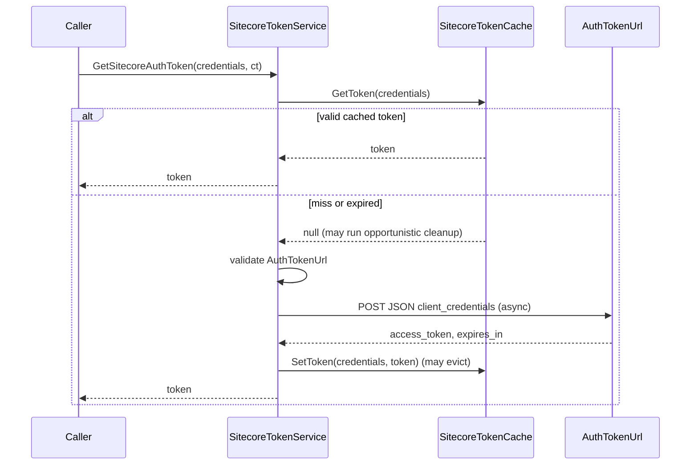

# Sitecore.API.Foundation.Authorization Blueprint

## System Overview

A .NET library that obtains and caches OAuth2 `client_credentials` bearer
tokens for Sitecore Cloud APIs. A caller passes `SitecoreAuthClientCredentials`
to `ISitecoreTokenService.GetSitecoreAuthToken`. The service returns a valid
cached token if one exists; otherwise it POSTs to the configured
`AuthTokenUrl` (default `https://auth.sitecorecloud.io/oauth/token`), validates
the response, stores the token in a singleton in-memory `ISitecoreTokenCache`,
and returns it. Hosts register everything with the `AddSitecoreAuthentication*`
extension methods.

## Subdirectories & System Boundaries

- Sitecore.API.Foundation.Authorization: [./Sitecore.API.Foundation.Authorization/README.md](./Sitecore.API.Foundation.Authorization/README.md) - The library project (NuGet `SitecoreAPIAuthorization`, `net8.0;net9.0;net10.0`), split into `Abstractions`, `Configuration`, `DependencyInjection`, `Exceptions`, `Models`, and `Services`.

## Global Invariants

- Secrets never leave the process except in the token request body: the
  `ToString()` methods of `SitecoreAuthClientCredentials` and
  `SitecoreAuthToken` mask `ClientSecret` and `AccessToken` as `***`, and no
  logger call emits either value or the raw OAuth response body.
- The token endpoint must be an absolute HTTPS URI, or HTTP to a loopback host,
  with no embedded `UserInfo`. This is checked on every cache miss before the
  request is sent.
- The token cache is a process-wide singleton (`TryAddSingleton`) even when
  `ISitecoreTokenService` is registered as `Scoped`.
- The public API stays backward compatible: single-parameter (no
  `CancellationToken`) overloads, the `SitecoreTokenService` constructor
  signature, `protected readonly HttpClient HttpClient`, and default DI
  lifetimes (`Scoped` / `Singleton`) are preserved.
- Library-specific failures surface as `SitecoreAuthException` or a subclass;
  pre-cancelled calls throw `TaskCanceledException`; refreshing a token that
  is not in the cache throws `ArgumentException`.
- Cache removals use `ConcurrentDictionary.TryRemove(KeyValuePair)`, so
  cleanup and eviction never delete a token that was concurrently replaced.

## Global Side Effects

- Outbound HTTPS `POST` to `SitecoreTokenServiceOptions.AuthTokenUrl` on each
  cache miss or refresh, through the named `HttpClient`
  `Sitecore.API.Foundation.Authorization.HttpClient` (or a caller-supplied
  `httpClientFactory`), with an optional `Microsoft.Extensions.Http.Resilience`
  standard handler.
- In-process memory: one `ConcurrentDictionary` of tokens per cache instance,
  bounded by `MaxCacheSize` (best effort) and pruned opportunistically on
  cache misses. No disk, database, or distributed cache.
- `ILogger` output when loggers are registered.

## System Verification

- Run: `dotnet test Sitecore.API.Foundation.Authorization.slnx` (from the repository root)
- CI equivalent (skips Docker Keycloak tests): `dotnet test --configuration Release --filter "FullyQualifiedName!~TokenServiceIntegrationTests"`
