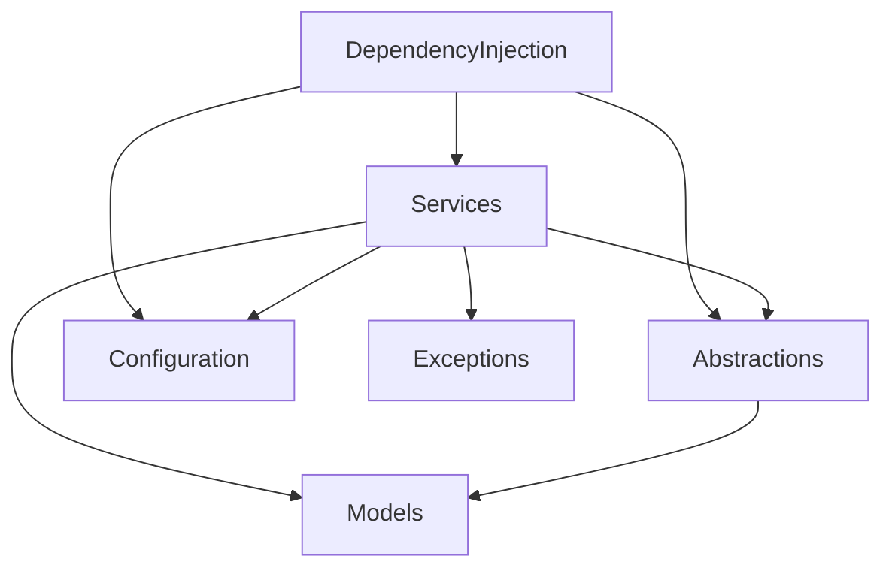

# Sitecore.API.Foundation.Authorization

## Overview

The single library project, packaged to NuGet as `SitecoreAPIAuthorization`
([`Sitecore.API.Foundation.Authorization.csproj`](./Sitecore.API.Foundation.Authorization.csproj)). It targets `net8.0`,
`net9.0`, and `net10.0`, with `Nullable` enabled and `ImplicitUsings`
disabled. Package dependencies: `Microsoft.Extensions.Configuration.Abstractions`,
`Microsoft.Extensions.DependencyInjection.Abstractions`,
`Microsoft.Extensions.Http`, `Microsoft.Extensions.Http.Resilience`,
`Microsoft.Extensions.Options`, and `Microsoft.Extensions.Logging.Abstractions`
(versions pinned centrally in [`Directory.Packages.props`](../../Directory.Packages.props)). Internals are
visible to `Sitecore.API.Foundation.Tests` and
`Sitecore.API.Foundation.Authorization.IntegrationTests`.

## Subdirectories & Boundaries

- Abstractions: [./Abstractions/README.md](./Abstractions/README.md) - Public `ISitecoreTokenService` and `ISitecoreTokenCache` contracts.
- Configuration: [./Configuration/README.md](./Configuration/README.md) - `SitecoreTokenServiceOptions` (cache limits, cleanup cadence, `AuthTokenUrl`) and internal OAuth2 `Constants`.
- DependencyInjection: [./DependencyInjection/README.md](./DependencyInjection/README.md) - `AddSitecoreAuthentication*` (Scoped) and `AddSitecoreAuthenticationSingleton*` registration, named `HttpClient`, optional standard resilience.
- Exceptions: [./Exceptions/README.md](./Exceptions/README.md) - `SitecoreAuthException` base with `SitecoreAuthHttpException` and `SitecoreAuthResponseException`.
- Models: [./Models/README.md](./Models/README.md) - Immutable `SitecoreAuthClientCredentials` and `SitecoreAuthToken` record structs with masked `ToString()`.
- Services: [./Services/README.md](./Services/README.md) - `SitecoreTokenService` (OAuth2 token acquisition and refresh) and `SitecoreTokenCache` (thread-safe in-memory cache with cleanup and eviction).

`Models`, `Exceptions`, and `Configuration` reference no other folder in this
project, except that `SitecoreTokenServiceOptions.AuthTokenUrl` defaults to
`Constants.SitecoreCloudAuthTokenUrl` within `Configuration`.
